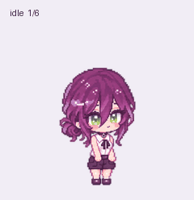

# Reze pet

A soft pixel chibi Reze with violet hair, green eyes, a white blouse, black ribbon, and ring choker.



## Use on another laptop

1. Download `spritesheet.png` from this repository (open the file and choose **Download raw file**).
2. Open a chat with the **Pets** plugin on your other laptop and attach the downloaded PNG.
3. Ask: **“Use this existing sprite sheet to create and select a pet named Reze. Preserve the artwork and all animation frames.”**

The PNG is the complete pet asset. The GIF and MP4 files are previews. Upload the PNG at its original resolution; do not use a screenshot or the preview GIF as the sprite sheet.

## Files

- `spritesheet.png` — transparent v2 pet sprite sheet, 1536 × 2288 pixels.
- `pet.json` — portable name, description, layout, animation timings, and SHA-256 checksum.
- `preview.gif` / `preview.mp4` — all nine animation states.
- `look-loop.gif` — all sixteen gaze directions.
- `validation.json` — summary of the completed checks.

The sprite sheet contains 73 populated frames in an 8-column, 11-row grid with 192 × 208 pixel cells. It includes idle, right/left running, waving, jumping, failure, waiting, active work, review, and sixteen clockwise gaze directions.

## Verification

SHA-256 of `spritesheet.png`:

```text
83076352ce0ba9802c1fcf44bff8223a28f2c20961a39ea206fe703b72bf0e1f
```

Artwork was generated with the built-in image generation tool from the supplied Reze reference and validated before being added to Pets.